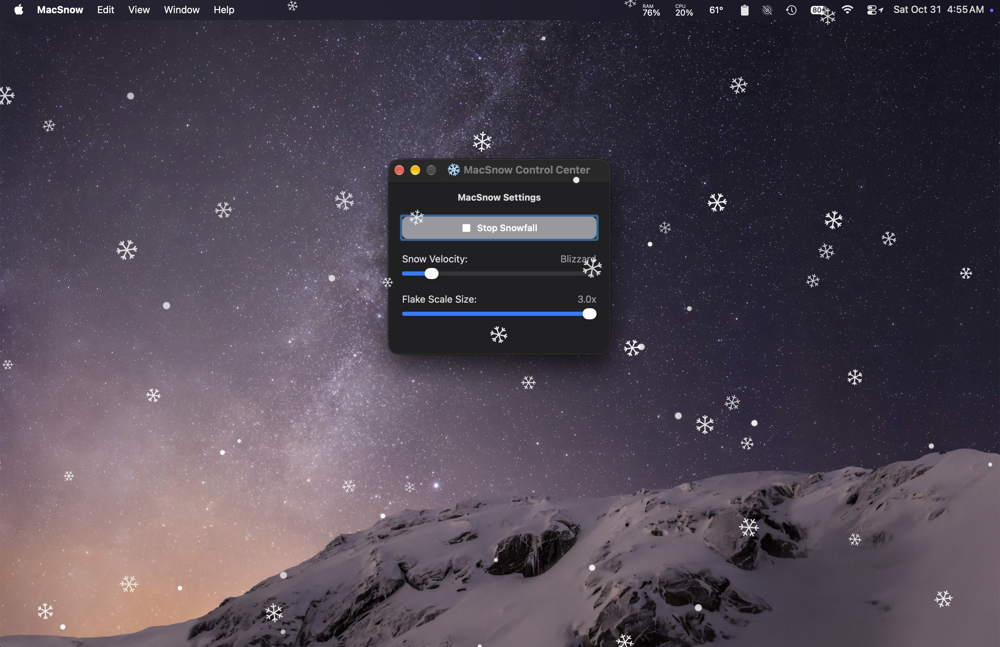

MacSnow v1.0.0 — Holiday Release ❄️

Welcome to the initial launch of MacSnow, a lightweight, high-performance holiday utility designed to bring a peaceful winter landscape directly to your macOS desktop. Inspired by classic vintage screen savers but re-engineered from scratch for modern hardware, MacSnow lets highly detailed vector snowflakes drift gently across your screen and float over your open windows.

This utility has been built from the ground up to be ultra-lean and energy-efficient so you can safely run it in the background all holiday season without draining your battery or spinning your Mac's fans.

Key Features

• High-Quality Crystal Geometries: Features randomized, mathematically generated 6-pointed star and needle crystal snowflake designs that slowly rotate and tumble as they fall.

• GPU-Accelerated Rendering: Utilizes an optimized vector symbol caching architecture. Complex snowflake shapes are drawn exactly once into your graphics memory on launch and transformed using hardware matrices, keeping CPU overhead down to a negligible 0%–1%.

• Seamless Multi-Display Support: Automatically detects your monitor setup and spawns transparent, click-through animation canvases across all connected displays.

• Interactive Control Center: Includes a dedicated, floating configuration panel to customize your snowfall in real time:

	• Start/Stop Toggle: Instantly activate the snowfall or halt processing to clear graphics memory completely.
	• Velocity Slider: Seamlessly scale the storm's velocity from a tranquil, creeping drift up to a dense, heavy gale.
	• Flake Scale Slider: Dynamically resize the flakes from a fine, subtle winter mist up to 2x larger, fluffy crystals.

Installation & Launch Instructions (Gatekeeper Bypass)

Because this application is built independently without an official Apple Developer certificate, macOS Gatekeeper will protectively flag it on your first launch. To run MacSnow safely:

1. Download the attached MacSnow.app.zip file from the assets section below and unzip it.
2. Drag MacSnow.app into your local Applications folder.
3. Do not double-click the app to open it first. Instead, Right-click (or Control-click) the app icon and select Open.
4. When the security prompt pops up asking to confirm the unverified developer, click Open to grant a permanent, local system exception.
